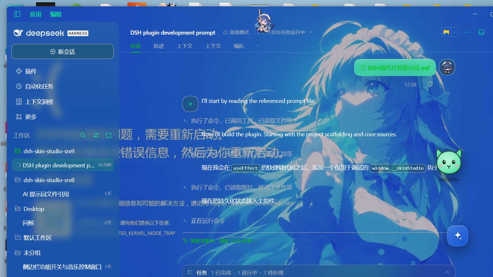
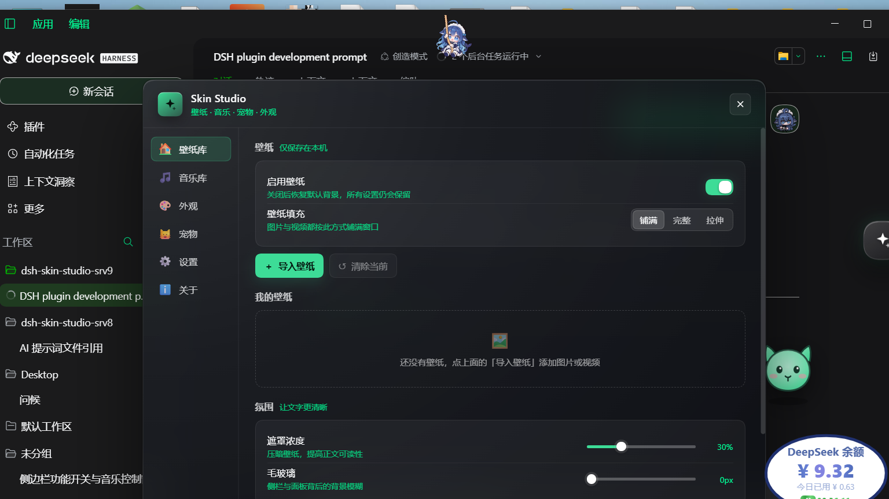

# Skin Studio · 壁纸与桌面美化

为 DeepSeek Harness 打造的桌面美化套件：透明壁纸、主题配色、音乐库、桌面宠物、聊天气泡与开场动画。
所有数据只保存在本机浏览器（localStorage + IndexedDB），不上传任何服务器。




## 功能

### 🏠 壁纸库
- 一键启用/关闭壁纸，DSH 主界面自动透明化（`body[data-dsss-wp]` + `--dsw-alias-bg-base: transparent`）
- 本地图片 / 视频壁纸，网格预览、收藏、切换、删除
- 填充方式：铺满 / 完整 / 拉伸（滑块式分段选择）
- 遮罩浓度 0–100%、毛玻璃 0–30px（侧栏与面板背景模糊）
- 壁纸声音：开关、选音频、随机播放、音量、播放间隔；音乐播放时壁纸声音自动暂停

### 🎵 音乐库
- 导入本地音乐（多选），列表播放，上一首/下一首/暂停
- 音量、悬浮小窗（可拖动、可关闭）
- 导入后不会自动播放

### 🎨 外观
- 8 组主题主色，联动按钮、高亮、边框、滑块与宠物光环
- 界面整体透明度、字体大小
- 时钟：开关、24 时 / 12 时 / 含秒、显示日期，可拖动到任意位置

### 🐱 宠物
- 默认停在右下角，可拖动，位置/大小/透明度都会记住
- 语录增删、表情包 GIF 增删、点击弹消息（消息跟随宠物）
- 自动随机消息、消息停留时间、表情出现概率
- 贴边隐藏：收进屏幕右侧，只留一枚半透明小图标
- 快捷键 `Ctrl + Alt + P` 显示 / 隐藏

### ⚙️ 设置
- 存储占用统计、清理孤儿文件
- 重置全部（带二次确认，清空 localStorage 与 IndexedDB）

### ℹ️ 关于
- 插件介绍、版本、项目主页占位链接

### 其它
- 双幕开场动画：第一幕 logo 缩放，1.5s 后交叉叠化到第二幕（自定义视频或标题文字），点击任意位置跳过，播完淡入主界面，默认关闭
- 聊天头像：用户 / AI 两套独立设置，头像框颜色、粗细、发光，气泡颜色与透明度（AI 气泡可单独开启）
- 右键菜单只有三项：显示/隐藏音乐、打开设置、显示/隐藏宠物
- 细灰自定义滚动条，所有修改即时生效并有过渡动效

## 快捷键

| 快捷键 | 作用 |
| --- | --- |
| `Ctrl + Alt + S` | 打开 / 关闭设置面板 |
| `Ctrl + Alt + P` | 显示 / 隐藏桌面宠物 |

悬浮球与宠物上右键可打开快捷菜单。

## 安装

本地开发目录直接以 link 方式安装：

```powershell
# 在 DSH 里执行（plugin_manager）
install_bundle  target = "dsh-skin-studio@link:C:/Users/Administrator/Desktop/dsh-skin-studio-srv9/plugin"
```

安装后刷新页面（Ctrl+R）即可看到右下角悬浮球与宠物。

## 目录结构

```
plugin/               ← 安装到 DSH 的 bundle（唯一交付物）
  package.json
  cordis.patch.yml
  index.js            host 侧空实现
  client.js           全部 UI 与逻辑（由 src/ 拼接生成）
  icon.svg
  locale/*.json       zh / en 文案
src/                  源码，按文件名顺序拼接
  01-head.js          loader 头、常量、工具函数
  02-css.js           全部样式
  03-store.js         设置模型、localStorage、IndexedDB
  04-ui-kit.js        开关 / 滑块 / 卡片 / 弹窗等基础组件
  05-media.js         音频、Blob URL
  06-tabs.js          六个标签页
  07-runtime.js       时钟、迷你播放器、宠物、右键菜单、开场动画
  08-app.js           主组件、壁纸层、body 属性
  09-tail.js          样式挂载与 slot 注册
tools/
  build.mjs           拼接 src → plugin/client.js
```

修改源码后重新构建：

```powershell
node tools/build.mjs
node --check plugin/client.js
```

## 存储

| Key / 库 | 内容 |
| --- | --- |
| `localStorage['skin-studio-settings']` | 全部设置 |
| `localStorage['pet-quotes']` | 宠物语录 |
| `localStorage['pet-emojis']` | 表情包 ID 列表 |
| `IndexedDB['skin-studio-db'] / files` | 壁纸、音乐、开场视频、头像、表情（Blob） |

## 已知限制

- 与 `dsh-plugin-wallpaper-engine` 功能重叠：两者都会改 body 背景与聊天头像，建议只启用其中一个。
- 壁纸为视频时依赖浏览器视频解码，超大视频（>200MB）首次加载会慢一些。
- 只保存文件到 IndexedDB，清理浏览器站点数据会一并丢失。
- 设置与文件对不上时会自动修复：IndexedDB 里还有文件、设置里却没了引用（清缓存、误触重置），下次启动会自动把壁纸 / 音乐 / 头像接回去。
